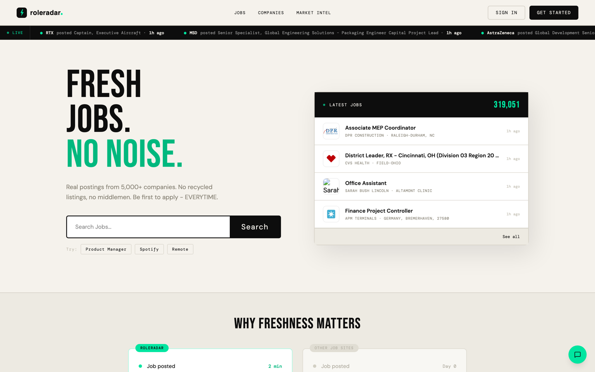
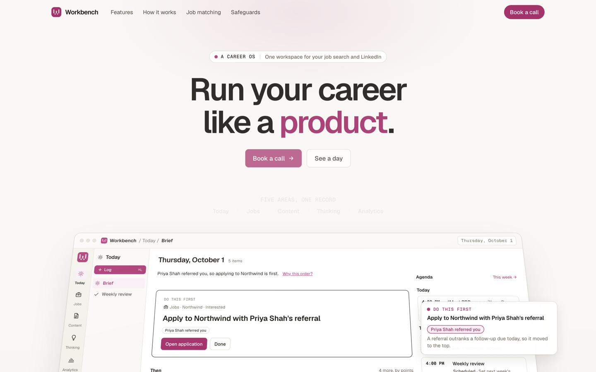
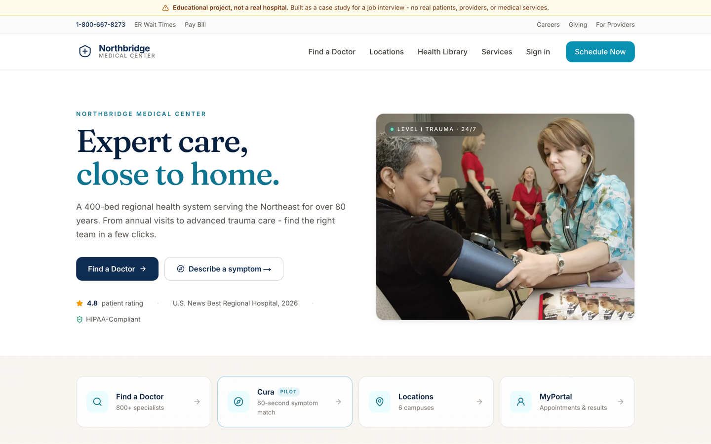

## Manish Rawal

Program Manager at Mount Sinai Health System, moving into AI product management. I take product ideas from first sketch to live users with Claude Code, and I run what I ship.

[mrawal.com](https://mrawal.com) · [LinkedIn](https://www.linkedin.com/in/rawalmanish) · [Book a 15-min chat](https://mrawal.com/?utm_source=github&utm_medium=profile&utm_campaign=cta)

### Products I built and run

The code for these is private. Each link opens the live product.

**[RoleRadar](https://roleradar.xyz)** · job discovery

RoleRadar surfaces roles from company career pages before they reach the big job boards. It reads Greenhouse, Lever, Ashby, Workday and SmartRecruiters boards, plus Amazon, Apple, Google and Microsoft, and puts the postings in one search. 5,000+ users.

**[Workbench](https://workbench.mrawal.com)** · a career OS

One app for my job pipeline, LinkedIn drafting and PM practice. It holds contacts and job-search data, so it stays private behind Cloudflare Access. Each fetch, AI read and rollup has one owner, and pages read stored results, so nothing is computed twice. The screenshot is the public landing page; the app itself is private.

**[Northbridge Medical](https://northbridge-medical.vercel.app)** · healthcare prototype

A fictional health system I designed and built for a product management interview. A patient describes symptoms and is routed to the right specialist in about 60 seconds. Not a real hospital; sign-in is simulated.

### Open source

| Repo | What it does | The call I made |
|---|---|---|
| [sync-agent-docs](https://github.com/manishrawal95/sync-agent-docs) | Finds conflicting, stale and duplicated infra facts across repos and coding-agent files | Local only, no AI and no network by default; every fix lands on its own branch, never pushed, with rollback |
| [openslot](https://github.com/manishrawal95/openslot) | Self-hosted booking page with Google Calendar, Meet links and reminders | Built it instead of paying for a scheduling subscription; guests reschedule from a signed link with no account |

### How I build

Every product above runs on one Claude Code setup: a project card per repo with its setup, test and deploy commands; a session on a server that survives a closed laptop; corrections saved as rules every session loads; and one build and release process for every project. Write-up on [mrawal.com](https://mrawal.com).

### Work

- Program Manager, Mount Sinai Health System (2025 to present). Worked on the TimeKeep employee self-scheduling rollout.
- Product Manager, Wonsulting (contract, 2025).
- MBA in Business Analytics, Babson College.
